# ha-certificate-card

[](https://www.home-assistant.io/integrations/marketplace/)
[](https://github.com/juju35/ha-certificate-card/actions/workflows/hacs.yml)
[](https://github.com/juju35/ha-certificate-card/actions/workflows/validate.yml)
[](https://github.com/juju35/ha-certificate-card/actions/workflows/lint.yml)
[](https://github.com/juju35/ha-certificate-card/releases/latest)
[](https://github.com/juju35/ha-certificate-card/blob/main/LICENSE)
[](https://buymeacoffee.com/julienstep9)

Lovelace cards for Home Assistant to keep an eye on your SSL/TLS certificates: which one expires next, how many days are left, which ones are already expired or invalid — plus a few basic DNS checks.

Supported integrations:

- [Certificate Expiry](https://www.home-assistant.io/integrations/cert_expiry/) — the expiry date of each monitored certificate;
- [DNS IP](https://www.home-assistant.io/integrations/dnsip/) — is the host name resolved, and to which address;
- [Ping](https://www.home-assistant.io/integrations/ping/), or any connectivity binary sensor — is the host reachable.

Certificates and DNS IP sensors are **discovered automatically**, you don't have to pick them one by one, and it works whatever your Home Assistant language.

[](https://my.home-assistant.io/redirect/marketplace_repository/?owner=juju35&repository=ha-certificate-card&category=plugin)

| Certificate Card | Certificate Mini Card |
|---|---|
| 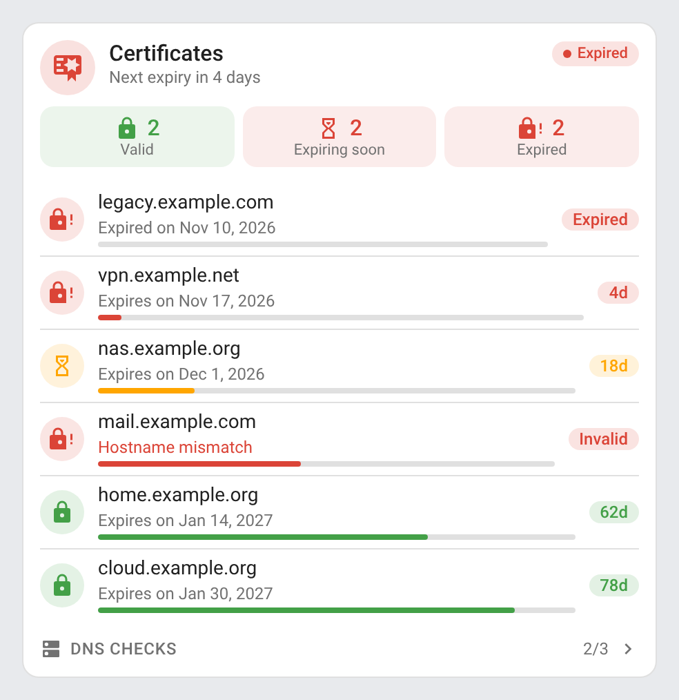 | 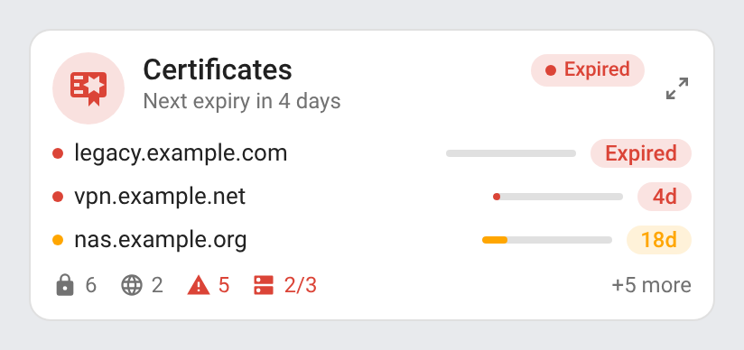 |

## Features

- Two cards: a full **Certificate Card** and a compact **Certificate Mini Card**
- Automatic discovery of every Certificate Expiry sensor; pick, rename or hide certificates if you prefer
- Certificates sorted by expiry, soonest first, each with its expiry date, the days left as a badge and a bar (full bar: 90 days, the lifetime of a Let's Encrypt certificate)
- Configurable thresholds: orange under 30 days, red under 7 days by default; expired and invalid certificates in red, with the error the integration reports (hostname mismatch…)
- Valid / expiring / expired counters, and an "only certificates needing attention" mode
- Header status: *All valid*, *Expiring soon*, *Expired*, *Invalid* or *DNS issue*, and the next expiry (*Next expiry in 4 days*)
- Optional DNS checks, in a section that folds and unfolds: DNS IP sensors (resolved or not, with the address) and Ping or other connectivity binary sensors (reachable or not)
- Click any row to open its Home Assistant history (more-info dialog)
- Detail button at the top right of the mini card: it switches to the full card and back; a click anywhere outside the card brings the compact view back
- The days left stay up to date: the card checks them every minute
- Visual editor in the dashboard UI for both cards (no YAML needed)
- Light and dark mode; English, French, German, Spanish, Serbian (Cyrillic and Latin), Italian, Dutch, European Portuguese, Polish, Romanian, Danish, Swedish, Bulgarian, Russian, Ukrainian, Hungarian, Slovak, Czech, Slovenian, Latvian and Greek
- Single file, no external dependency

## Supported integrations

| Integration | What the cards show |
|---|---|
| [Certificate Expiry](https://www.home-assistant.io/integrations/cert_expiry/) (built in) | One row per certificate: host name, expiry date, days left, valid / expiring / expired / invalid with its error. Found automatically through the entity registry |
| [DNS IP](https://www.home-assistant.io/integrations/dnsip/) (built in) | One DNS check per sensor: the resolved address, or *Not resolved*. Found automatically through the entity registry |
| [Ping](https://www.home-assistant.io/integrations/ping/) (built in), or any connectivity binary sensor | One DNS check per entity: *Reachable* or *Unreachable*. Listed by hand with `dns_entities` (a Ping sensor often tracks a phone or a computer, not a server) |

Any other timestamp sensor holding an expiry date (a domain expiry sensor, say) can be listed with `entities`, and so can a sensor holding a number of days left.

## Prerequisites

Home Assistant 2024.8 or later, and the [Certificate Expiry integration](https://www.home-assistant.io/integrations/cert_expiry/) set up for each host to watch (**Settings → Devices & services → Add integration → Certificate Expiry**: host and port). The DNS checks need the [DNS IP integration](https://www.home-assistant.io/integrations/dnsip/) for each host name, or [Ping](https://www.home-assistant.io/integrations/ping/) sensors.

## Installation

### Via the Marketplace (recommended)

Click the button below to add the repository directly:

[](https://my.home-assistant.io/redirect/marketplace_repository/?owner=juju35&repository=ha-certificate-card&category=plugin)

Then click **Install**, and reload your browser when the Marketplace asks you to.

Or manually:

1. Open **Settings → Marketplace → Add from link** (top right; this needs a GitHub account connected)
2. Add `https://github.com/juju35/ha-certificate-card` — Type: **Dashboard**
3. Open **Certificate Card** and click **Install**
4. Clear your browser cache and refresh

### Manual

1. Download `certificate-card.js` and the `certificate-card.i18n.*.js` translation files from the [latest release](https://github.com/juju35/ha-certificate-card/releases/latest)
2. Copy them all to `/config/www/` (without the translation files, the cards show in English)
3. Go to **Settings → Dashboards → ⋮ → Resources** → Add resource:
   - URL: `/local/certificate-card.js`
   - Type: **JavaScript Module**
4. Clear your browser cache and refresh

## Configuration

### Visual editor

Edit a dashboard, click **Add card** and search for **Certificate Card** or **Certificate Mini Card**. Every Certificate Expiry sensor is listed by default; pick some of them, hide others, set the thresholds, choose the sections to display and the language. The preview updates live, and options left at their default are kept out of the generated YAML.

### Minimal

```yaml
type: custom:certificate-card
```

```yaml
type: custom:certificate-mini-card
```

### Full options

```yaml
type: custom:certificate-card
title: Certificates
entities:
  - sensor.home_example_org_cert_expiry
  - entity: sensor.vpn_example_net_cert_expiry
    name: VPN
exclude:
  - sensor.old_example_com_cert_expiry
warning_days: 30
critical_days: 7
show_counts: true
show_date: true
only_problems: false
show_dns: true
dns_entities:
  - sensor.home_example_org_ipv4
  - binary_sensor.gateway
expand_dns: false
language: fr
```

```yaml
type: custom:certificate-mini-card
max_items: 3
warning_days: 30
critical_days: 7
show_dns: true
zoom: true
language: fr
```

### Options reference

| Option | Card | Default | Description |
|---|---|---|---|
| `title` | both | Certificates | Card title |
| `show_title` | both | `true` | Show the title in the header (e.g. `false` under a section heading of your own) |
| `show_subtitle` | both | `true` | Show the next expiry under the title |
| `entities` | both | Every Certificate Expiry sensor | Certificates to list: entity ids, or `entity` / `name` pairs to rename a row. A timestamp sensor gives the expiry date, a numeric sensor the days left |
| `exclude` | both | — | Certificates to hide (with automatic discovery) |
| `warning_days` | both | `30` | Days left under which a certificate turns orange |
| `critical_days` | both | `7` | Days left under which a certificate turns red |
| `show_counts` | full | `true` | Valid / expiring / expired counters |
| `show_date` | full | `true` | Expiry date under each certificate (`false`: *in 18 days* instead) |
| `only_problems` | full | `false` | Only list the certificates that are expiring soon, expired or invalid |
| `show_dns` | both | `true` | DNS checks (shown when there is at least one) |
| `dns_entities` | both | Every DNS IP sensor | DNS checks to show: DNS IP sensors, Ping or other connectivity binary sensors; entity ids or `entity` / `name` pairs |
| `expand_dns` | full | `false` | DNS checks expanded when the card loads (click the section title to fold / unfold) |
| `max_items` | mini | `3` | Number of certificates listed, the soonest to expire first |
| `zoom` | mini | `true` | Detail button at the top right: switches to the full card and back (`false` removes it) |
| `language` | both | Auto | Force language: `en`, `fr`, `de`, `es`, `sr`, `sr-Latn`, `it`, `nl`, `pt`, `pl`, `ro`, `da`, `sv`, `bg`, `ru`, `uk`, `hu`, `sk`, `cs`, `sl`, `lv` or `el` (auto-detects from HA settings) |

## Screenshots

| Light | Dark |
|---|---|
|  | 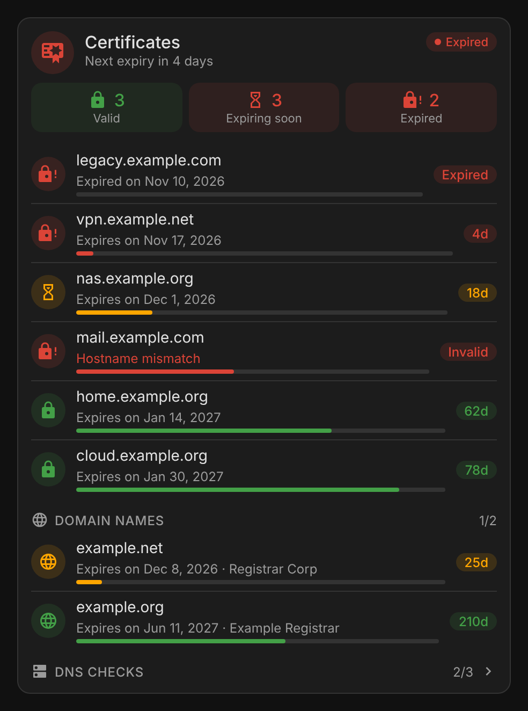 |
|  | 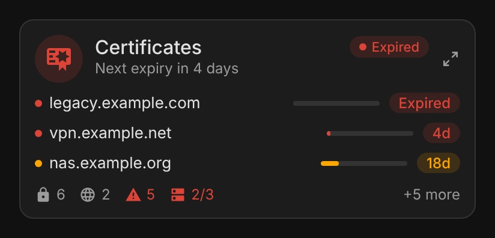 |
| 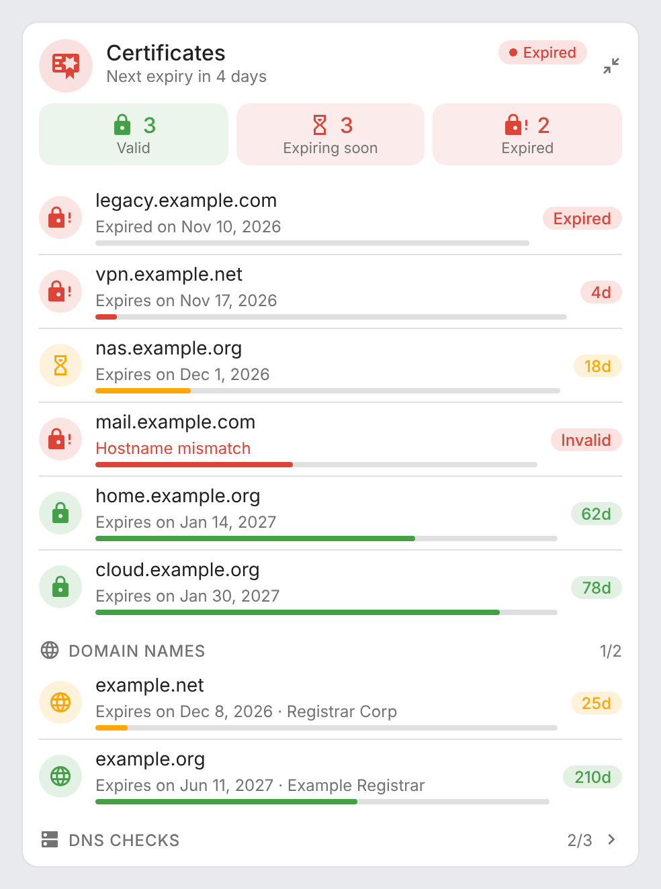 | 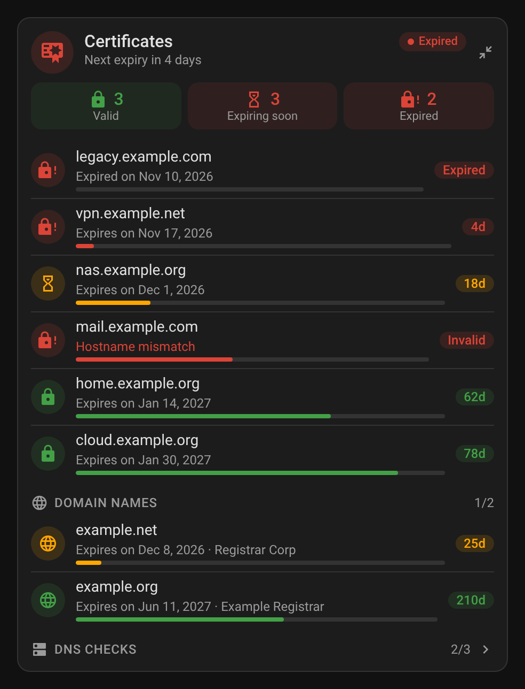 |

DNS checks expanded, with a Ping sensor (`dns_entities`, `expand_dns: true`):

| Light | Dark |
|---|---|
| 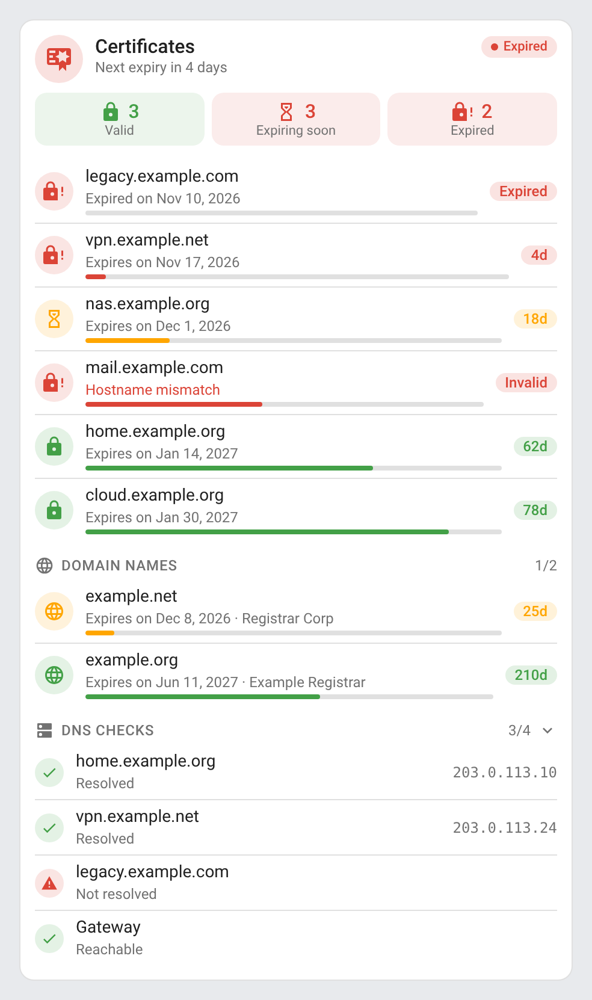 | 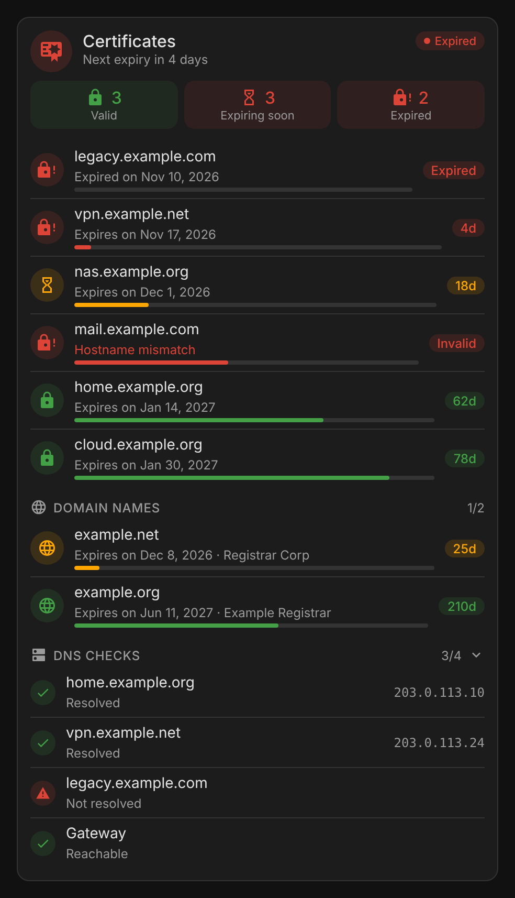 |

Only certificates needing attention (`only_problems: true`, no counters, no DNS checks):

| Light | Dark |
|---|---|
| 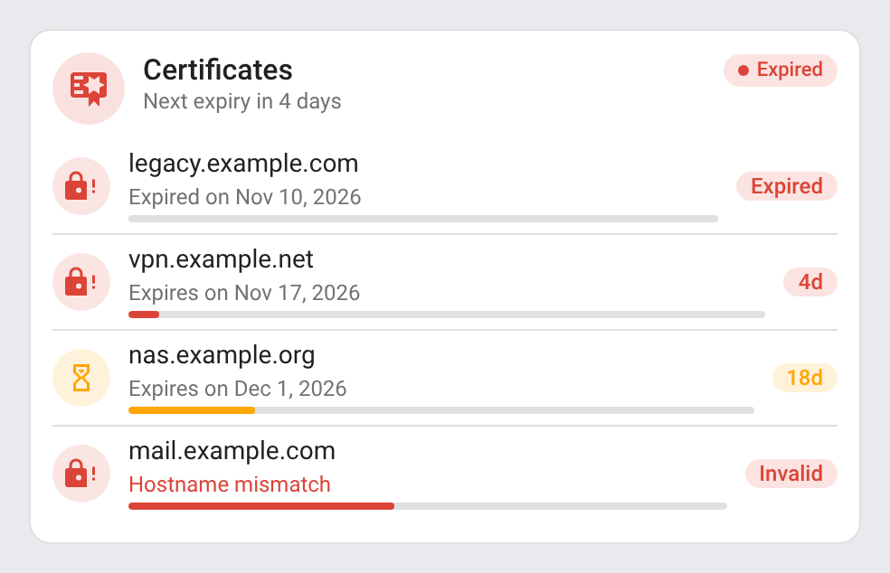 | 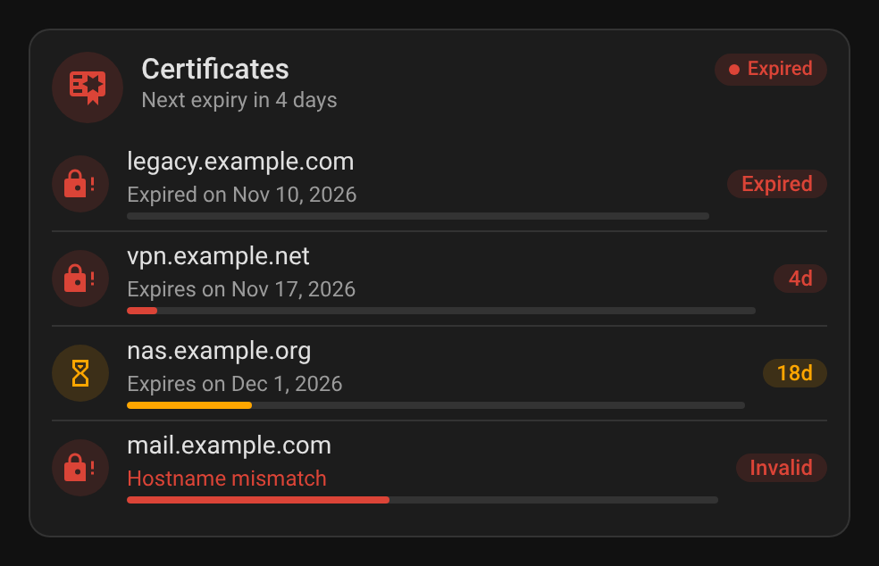 |

### Animations

| Animation | Light | Dark |
|---|---|---|
| Folding DNS checks | 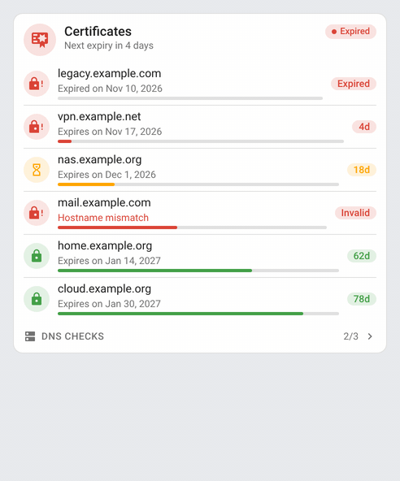 | 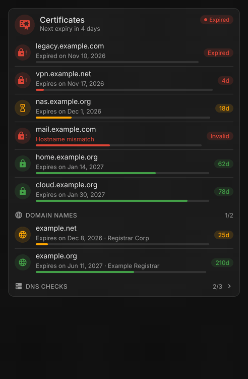 |
| Certificate renewed | 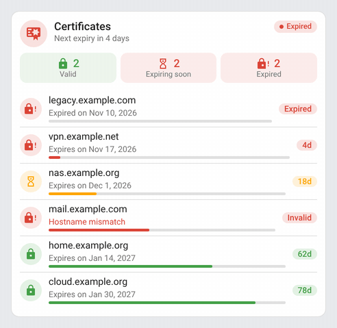 | 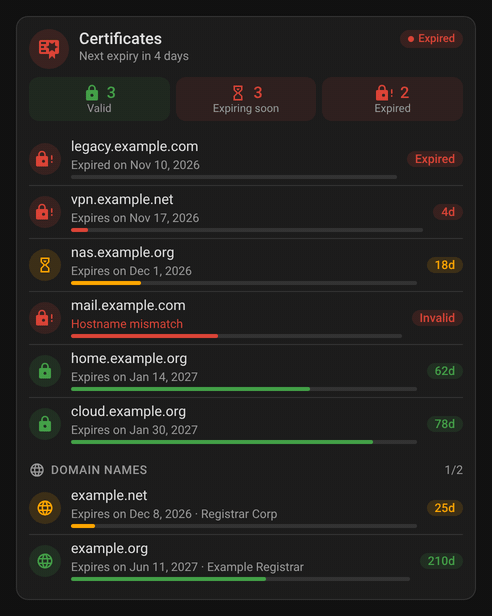 |
| Mini card detail button | 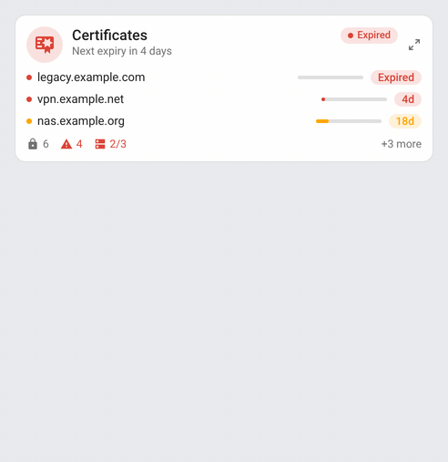 | 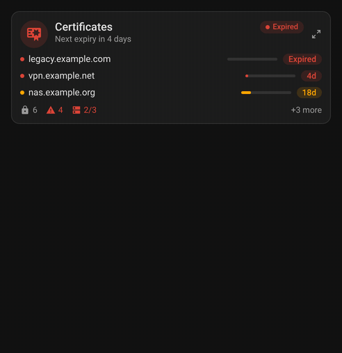 |

- `card-dns.gif` / `card-dns-dark.gif` — the DNS checks fold and unfold on a click on their title, with the chevron turning from right to down.
- `card-renewal.gif` / `card-renewal-dark.gif` — a certificate expiring in 4 days is renewed: its bar fills up, its badge turns green and the rows reorder by expiry.
- `mini-card-zoom.gif` / `mini-card-zoom-dark.gif` — the detail button switches the mini card to the full card and back.

## How it works

The cards read the Home Assistant entity registry: every sensor of the Certificate Expiry integration (platform `cert_expiry`) is a certificate, every sensor of DNS IP (platform `dnsip`) a DNS check. Entity ids can therefore be in any language or renamed without breaking the cards. A row is named after its device — a Certificate Expiry device carries the host name — unless you give it a `name`.

A certificate's state is its expiry date. The days left are counted from now and checked every minute:

| Days left | Colour | Status |
|---|---|---|
| `warning_days` (30) or more | green | Valid |
| under `warning_days` | orange | Expiring soon |
| under `critical_days` (7) | red | Expiring soon |
| none left | red | Expired |
| any, but the integration reports the certificate invalid | red | Invalid, with its error |

The header shows the most urgent status: an expired certificate first, then an invalid one, one expiring soon, then a DNS check failing; a click on it opens that entity.

A DNS IP sensor holds the address the host name resolves to, and becomes *unknown* when it does not resolve: the card shows *Not resolved* in red. A binary sensor is *Reachable* when on, *Unreachable* when off.

## Development

```bash
npm install
npm run build        # bundles src/certificate-card.js into dist/certificate-card.js
npm run check        # builds and checks the card (run in CI)
npm test             # unit tests
npm run screenshots  # renders the cards with mock data (scripts/mock-states.mjs) into screenshots/, PNG and animated GIF (needs ffmpeg)
```

The **Screenshots** workflow re-renders `screenshots/` on every pull request touching `src/`, `scripts/`, `images/` or `package-lock.json` (a Playwright/Chromium bump changes the rendering) and commits the refreshed captures onto the pull request's branch, so the README always matches the code. The captures are taken at a fixed date, so they only change when the cards do.

`dist/` is not committed: `npm run build` creates it locally, CI builds it on every push, and the release workflow attaches the built files to the release, which is where the Marketplace installs them from.

### Releasing

1. Bump `version` in `package.json`
2. Add a `## <version>` section at the top of [CHANGELOG.md](https://github.com/juju35/ha-certificate-card/blob/main/CHANGELOG.md)
3. Push to `main`: the **Release** workflow builds the card, creates the tag and the GitHub release with the changelog section as notes, and attaches `certificate-card.js` and its translation files

## Translations

The cards auto-detect the language from your Home Assistant settings. Currently supported:

| Language | Code |
|---|---|
| English | `en` |
| Français | `fr` |
| Deutsch | `de` |
| Español | `es` |
| Српски | `sr` |
| Srpski (latinica) | `sr-Latn` |
| Italiano | `it` |
| Nederlands | `nl` |
| Português (European) | `pt` |
| Polski | `pl` |
| Română | `ro` |
| Dansk | `da` |
| Svenska | `sv` |
| Български | `bg` |
| Русский | `ru` |
| Українська | `uk` |
| Magyar | `hu` |
| Slovenčina | `sk` |
| Čeština | `cs` |
| Slovenščina | `sl` |
| Latviešu | `lv` |
| Ελληνικά | `el` |

Dates, days left and relative times (*in 4 days*) are formatted by the browser in the card's language. Contributions for additional languages are welcome!

## License

[MIT](https://github.com/juju35/ha-certificate-card/blob/main/LICENSE)

## Support

If you find this project useful, you can support its development:

<a href="https://buymeacoffee.com/julienstep9"></a>
